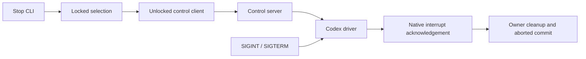

# waap

`waap` is an agent automation platform that structures execution of disposable AI agents.

`waap` is similar in spirit to [Gas Town](https://github.com/gastownhall/gastown), but without the exhaust, and [Omnigent Polly](https://github.com/omnigent-ai/omnigent), but without the omni.


## Motivation

I found that an effective pattern for running autonomous agents was making a `TODO.md` and pointing the agent to it with a `/goal`. `waap` formalizes this approach, promoting tickets and agents to first class. It persists context into files to get you out of the "my chat history is my context" approach, parallelizes agent execution, and rapidly gets you to [level 8](https://www.augmentcode.com/guides/steve-yegge-8-levels-ai-assisted-development).

For each repository, waap stores state in a dedicated `waap` branch worktree under `~/.local/state/waap/data/`. The resolved worktree is referred to below as `${waap_data}` and is reported by `waap check`.

## Design

`waap` uses two types:

1. `waap` tickets describe implementation work and live at `${waap_data}/tickets/<ticket-id>/ticket.md`.
2. `waap` agents contain agent instructions, e.g. `AGENTS.md`, and live at `${waap_data}/agents/<agent-id>/agent.md`.

The records use TOML frontmatter for structured `waap` metadata and the markdown body for unstructured content. The schema is intentionally plain text for agent-friendliness, and can be validated anytime with `waap check` using the `waap` CLI. The records are persisted in `git` so that agents can refer to past context.

Frequently but not always, agents are assigned to work on tickets.

Tickets can include one or more dependencies to create arbitrary directed acyclic graphs (DAGs). This allows you to create a multi-step implementation plan up front, specify complex workflows, and also parallelize agent execution as wide as your workflow allows.

## `waap` Workflow

In a `git` repo, initialize a new `waap` project:

```sh
waap init
```

For a repository that still has `.waap`, run `scripts/migrate-legacy-waap.py` from its primary checkout instead. If the repository is moved later, run `waap repair` to relocate and repair its state worktree.

Then create a ticket that describes the work to be done:

```
printf "Implement the file picker" | waap ticket new --name="File Picker"
```

This creates a `ticket.md` file at `${waap_data}/tickets/tt-file-picker/ticket.md` like

```
+++
name = "File Picker"
creation_date = 2026-07-06T10:44:50Z
status = "pending"
+++

Implement the file picker
```

Next create an agent to work on the ticket:

```
printf "Continue working on `tt-file-picker` until done" | waap agent new --name="File Picker Implementer"
```

This creates an `agent.md` file at `${waap_data}/agents/aa-file-picker-implementer/agent.md` like

```
+++
name = "File Picker Implementer"
creation_date = 2026-07-06T10:47:39Z
status = "ready"
+++

Continue working on `tt-file-picker` until done
```

Then run your agent with `waap agent run --agent-id aa-file-picker-implementer`.

Steer a running agent with `waap agent steer --agent-id aa-file-picker-implementer --prompt "Focus on keyboard navigation"`.

## `waap` Loop

For more complex workflows, follow the same idea but with multiple tickets and use a `waap` loop:

1. While there are unblocked tickets,
    1. Create agents to complete the work.
    2. Run the agents.
    3. Add new tickets as needed.

## CLI

For a full CLI description, check:

```
waap --help
waap ticket --help
waap agent --help
```

## Skill Resources

Use `waap` with an agent referencing the `waap` skill:

1. `.agents/skills/waap/SKILL.md` describes the waap workflow and CLI reference.
2. `.agents/skills/waap/roles/planner/agent.md` has a recommended `agent.md` for a planner role.
3. `.agents/skills/waap/roles/developer/agent.md` has a recommended `agent.md` for a developer role.

The skill also includes examples of using a `waap` loop to build a [software factory](https://github.com/chadvoegele/waap/blob/main/.agents/skills/waap/SKILL.md#software-factory-loop) and to run a [structured agent program](https://github.com/chadvoegele/waap/blob/main/.agents/skills/waap/SKILL.md#structured-agent-program-loop).

## Build

To build:

```sh
cargo build
cargo build --release
```

To run checks:

```sh
cargo clippy
cargo fmt --check
cargo test
```

To run the end-to-end test:

Ask an agent to run `.agents/skills/waap-heat-equation-e2e-test/SKILL.md`.

## Stopping agents

Use `waap agent stop --agent-id <id>` to stop one agent, or `waap agent stop`
to select all running agents. An explicitly selected ready agent is cancelled
locally; stop-all leaves ready agents alone.

Running Codex agents receive stop through their existing control socket under
`XDG_RUNTIME_DIR`, using native `turn/interrupt` on the current turn. SIGINT and
SIGTERM use the same interruption mechanism. The run owner cleans up its socket,
owned app-server child and worktree, then records `aborted` after successful
interruption. Rejected or failed interruption remains a failure. Claude and
OpenCode keep their existing backend stop behavior.

For Codex, successful CLI output confirms native acceptance; cleanup and terminal
persistence may still be in progress. The JSON shape remains `stopped_agents`
and `commit`: a reported agent may still be `running`, and a Codex-only stop has
`commit: null` because the owner commits its final status. Human output says
`Stop accepted for agent` while that agent remains running. Inspect `waap agent get`
for its final state.

Connect and frame I/O each allow five seconds; native acknowledgement allows
30 seconds, plus five seconds for response delivery. The owner also bounds
interrupted completion to 30 seconds after acknowledgement. Shutdown drains
bounded in-flight handlers before removing the socket. Missing/stale sockets,
startup before socket publication, or older runners lacking stop support return
errors without changing state. Lost delivery or acknowledgement reports unknown
acceptance; waap does not retry, discover processes, repair state, or fall back to
signals for Codex.


