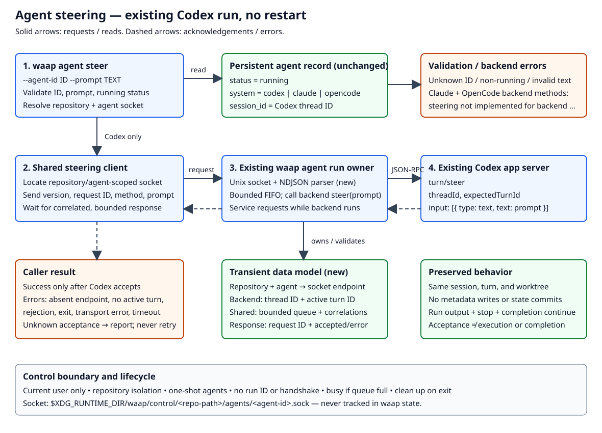

+++
status = "draft"
created = 2026-10-20
last_update = 2026-10-20
+++

# Agent steering

## Purpose

Let users redirect a running waap agent without stopping or restarting it.
The first implementation supports Codex; other backends explicitly reject steering.

## Context

Codex runs through an app-server connection owned by the live `waap agent run`
process. A separate CLI invocation cannot write to that connection directly.
Steering therefore needs a local control interface to the existing run process,
which retains ownership of the Codex thread, active turn, and protocol stream.



## Goals

- Submit a prompt to a running Codex agent's current turn.
- Report acceptance or failure to the caller.
- Preserve the existing session, worktree, and lifecycle.
- Reject unsupported backends explicitly.

## Non-goals

- Starting, resuming, restarting, or stopping an agent.
- Editing agent instructions or ticket content.
- Steering Claude or OpenCode in this PR; support may follow in future PRs.
- Broadcasting, durable message queues, or automatic delivery retries.
- Repairing stale lifecycle metadata or guaranteeing that an agent follows a prompt.

## Specification

### CLI

```sh
waap agent steer --agent-id "$agentid" --prompt "$prompt"
```

Both flags are required. The prompt must contain at least one non-whitespace
character. Validation must not trim or otherwise alter the submitted text.
Multiline text, Unicode, quotes, and shell metacharacters must be preserved.
The prompt is data, not a shell command.

The command must resolve the agent in the current repository's waap state and
reject unknown IDs or records whose status is not `running` before delivery.
Persisted `running` status is sufficient for the status check; no separate
process-liveness probe is required. Stale records fail through delivery rather
than triggering lifecycle repair.

The CLI and shared orchestration must support steering without backend-specific
rejections. The live run must dispatch to its active backend run interface's
steering method. Existing persisted backend selection and legacy default behavior
must remain unchanged. Claude and OpenCode must implement that method by returning
an unsupported error, surfaced as a nonzero CLI exit code with:

```text
steering not implemented for backend <backend>
```

### Delivery and acknowledgement

The steering command must send the unchanged prompt to the live run process
through a backend-neutral local control interface. Shared `agent run`
orchestration owns the socket, message parsing, buffering, and responses, then
calls the active backend run interface's steering method. The Codex implementation
must submit it on its existing app-server connection using `turn/steer`
with `threadId`, `expectedTurnId`, and a text `input` item. The expected turn ID
must be the active turn owned by that run, not a new or resumed turn.

Success means Codex acknowledged acceptance of the steering request. Merely
connecting or locally queueing a request is not success. The command must not
wait for the agent to act on the message or finish its turn. Human-readable
output must identify the agent and confirm acceptance; JSON output must identify
`agent_id` and indicate `accepted: true`, following existing output conventions.

The live run must continue processing Codex events while accepting control
requests. Responses must be correlated to their requests so simultaneous steering
calls cannot receive each other's acknowledgements or interfere with run output.

Missing control endpoints, startup before an active turn exists, exited runs,
completed turns, transport errors, Codex rejection, and acknowledgement timeouts
must produce a nonzero exit code and a clear diagnostic. Connection and
acknowledgement waits must be bounded. If delivery may have occurred but cannot
be confirmed, the diagnostic must say acceptance is unknown. There must be no
automatic retry, fallback to `turn/start`, or delivery to a later run.

### Control socket and lifecycle

Shared `waap agent run` orchestration must open a Unix-domain stream socket for
all backends. Claude and OpenCode requests reach their backend steering methods,
which return the not-implemented error; higher layers must not special-case them.

Define `waap_runtime_dir = $XDG_RUNTIME_DIR/waap`. The socket path is:

```text
$waap_runtime_dir/control/<repository-relative-path>/agents/<agent-id>.sock
```

`<repository-relative-path>` must reuse the repository naming scheme under
`~/.local/state/waap/data/`, so state and runtime layouts are symmetric and all
worktrees of one repository resolve the same socket. `XDG_RUNTIME_DIR` is a
runtime directory, typically `/run/user/$UID`, not `~/.local/state` (the default
persistent `XDG_STATE_HOME`). The socket must not be placed in the waap state
worktree or tracked by Git. No persisted endpoint registry is required.

Runtime directories must be private to the current OS user, and socket access
must be restricted to that user. Missing or empty `XDG_RUNTIME_DIR`, a runtime
directory not owned by the current user, or one accessible by other users must
fail clearly. No fallback directory is permitted. Socket paths exceeding platform
limits must also fail clearly; there must be no alternate naming scheme. The endpoint must be ready to handle requests before accepting
them and must be closed and removed on normal run exit. A crash may leave a
socket file; connecting to that stale endpoint must fail clearly, without state
repair or automatic reconnection.

Agents are one-shot. The socket identifies the repository and agent; no run ID,
backend session ID, handshake, or capability negotiation is required on the wire.
Each CLI call connects once and must not reconnect automatically.

### Control protocol and buffering

The socket protocol must be backend-neutral NDJSON encoded as UTF-8, with one
request and one response per connection. A newline terminates each JSON object;
newlines inside prompts are JSON-escaped. Version 1 steering requests have:

```json
{"version":1,"request_id":"uuid","method":"steer","prompt":"Focus on the failing test."}
```

The client generates `request_id`; the server echoes it in the response. Requests
must not contain Codex thread or turn IDs. The server must reject malformed
requests, unsupported versions, unknown methods, and invalid prompts without
calling the backend. A valid request receives one of these response shapes:

```json
{"version":1,"request_id":"uuid","accepted":true}
```

```json
{"version":1,"request_id":"uuid","accepted":false,"error":{"code":"busy","message":"Steering queue is full."}}
```

`accepted: false` means the request is known not to have been accepted. If backend
delivery may have occurred without acknowledgement, the error response must use
`accepted: null` and error code `acceptance_unknown`; the CLI reports failure with
that uncertainty. If no trustworthy request ID can be parsed, a protocol-error
response may use `request_id: null` before closing the connection. Other errors
include `invalid_request`, `unsupported_version`, `unknown_method`,
`not_implemented`, `no_active_turn`, `agent_exited`, `backend_rejected`,
`request_too_large`, `timeout`, and `unsupported_backend_version`.

Shared orchestration must use a bounded, in-memory FIFO queue for concurrent
requests, dispatching them sequentially to the backend. Ordering is determined by
server enqueue order, not client invocation time. Queueing is not acceptance;
responses follow backend acknowledgement or rejection. A full queue must reject
excess requests with `busy`. Pending requests must be rejected with `agent_exited`
if the agent finishes before dispatch. No requests survive the run.

### Resource limits and deadlines

The following limits are required for the initial implementation:

| Resource | Limit | Required behavior |
| --- | --- | --- |
| Socket connection | 2 seconds | Fail clearly if connection cannot be established |
| Steering acknowledgement | 30 seconds, including queue time | Expire undispatched requests; report uncertainty after unconfirmed dispatch |
| Pending steering queue | 16 requests, plus one being dispatched | Reject overflow immediately with `busy` |
| Request frame | 64 KiB, including JSON overhead and terminating newline | Reject larger frames with `request_too_large` |
| Concurrent control connections | 32 per agent | Immediately close excess accepted connections without allocating request buffers |
| Incomplete request | 5 seconds from connection acceptance | Close if a complete frame has not arrived |

The client acknowledgement deadline starts after it sends the complete request;
the server's 30-second deadline starts when it receives the complete frame. These
are monotonic deadlines and must not reset when a request moves out of the queue.
The client must not report a transport timeout as definite rejection when it lacks
a response establishing that fact.

Before dispatching, the server must check the request deadline. A request that
expires while queued must be removed without calling the backend and receive
`accepted: false` with `timeout`. After dispatch, missing acknowledgement by the
deadline must produce `accepted: null` with `acceptance_unknown`, not a definite
rejection. No automatic retries are permitted. A timed-out dispatched operation
must not cause concurrent backend dispatch or corrupt response correlation when
a late acknowledgement arrives.

Shared orchestration must service control connections while waiting for backend
completion, and the backend must continue processing events during steering.
It must not block exclusively in the existing `wait()` interface. Parsing,
queueing, and response correlation belong to shared orchestration; Codex protocol
multiplexing and thread/turn details belong to the Codex backend.

### Interfaces and data model

The following are logical interface contracts, not mandated Rust type names:

| Interface | Input | Result |
| --- | --- | --- |
| CLI / shared steer orchestration | Agent ID, prompt | Validate record, resolve socket, send request |
| Shared run control server | Version, request ID, method, prompt | Parse, validate, queue, invoke backend, respond |
| Active backend run interface: `steer(prompt)` | Unchanged prompt | Accepted or descriptive error; Claude/OpenCode return not implemented |
| Local run control response | Request ID, acceptance, optional error | Correlated result or acceptance unknown |
| Codex app-server request | `turn/steer { threadId, expectedTurnId, input: [{ type: "text", text: prompt }] }` | Protocol acknowledgement or error |

Existing persistent agent metadata remains unchanged: `status`, `system`, and
`session_id` retain their meanings; Codex `session_id` is its thread ID. Steering
must not rewrite these fields, modify `agent.md`, or create a waap state commit.

Transient shared state consists of the socket, pending connections, bounded queue,
and request correlations. The Codex backend alone owns its thread ID, active turn
ID, and app-server connection. There is no new persisted waap state, run ID, or
handshake state. Prompts must not be added to routine diagnostics.

### Compatibility

Codex steering must use native `turn/steer` and be tested against the supported
Codex app-server version. If the server lacks that method, the Codex backend must
return `unsupported_backend_version` with a diagnostic identifying the missing
method. It must not emulate steering by restarting, resuming, or starting a turn.

Existing run, stop, state, and worktree behavior must remain unchanged. Steering
must not mark a run completed, aborted, or otherwise alter its lifecycle status,
including on delivery failure. No persistent state migration is required.

## Verification

- CLI tests: required flags, whitespace-only rejection, exact preservation of
  nonempty text, and human/JSON success output.
- Orchestration tests: unknown agent, every non-running status, active backend
  dispatch, Claude/OpenCode not-implemented responses originating in their backend
  implementations, and no state changes or commits.
- Protocol tests: correct `turn/steer` payload, expected active turn ID, Codex
  acceptance/rejection, and response correlation amid unrelated notifications.
- Local-control integration tests: deliver to an already-running fake Codex
  app server through the run owner, without starting another session or turn;
  concurrent requests, FIFO dispatch, queue saturation returning `busy`, and
  pending-request rejection on exit; bounded timeouts; exit during submission;
  startup and completed-turn rejection; ambiguous acknowledgement loss without
  retry; NDJSON framing, version/schema validation, and request correlation.
- Limit/deadline tests: 2-second connection timeout, 30-second acknowledgement
  deadline including queue time, 16 pending requests plus one dispatch, 64-KiB
  frame boundary, 32-connection cap, and 5-second incomplete-frame timeout.
  Use controlled clocks where possible. Verify expired queued requests never
  reach the backend and late acknowledgements cannot corrupt later responses.
- Codex compatibility tests: native `turn/steer` against the supported app-server
  version and missing-method rejection without restart or new-turn fallback.
- Isolation/lifecycle tests: symmetric socket lookup across repository worktrees,
  same agent ID in two repositories, stale endpoint, restricted endpoint access,
  path-length errors without alternate naming, missing/empty or insecure
  `XDG_RUNTIME_DIR` rejection without fallback, and normal cleanup; no run ID or
  handshake is required.
- Regression tests: run output, stop interruption, completion, and worktree cleanup
  continue to work while steering requests are processed.

