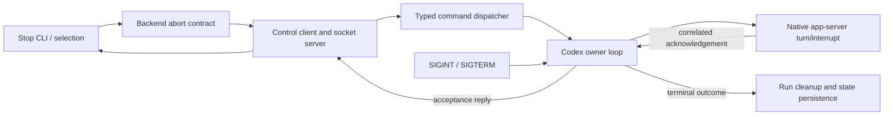
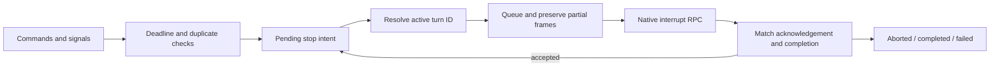

# PR #12 — line-by-line CODE.md audit

Reviewed complete `origin/main...HEAD` diff based on `b2ccb02923c19bf083fc3d3d6e11c3cf17fd4fef`, feature baseline `aab4fe368cbcccce73f08fd200c60b52f9aecfff`, plus this audit's focused fix. Evidence points to final source after the fix. The report commit identifies its own exact snapshot; audit/report prose is not a claim about future PR revisions.

Read in full: `/home/chad/.pi/agent/CODE.md`, repository `AGENTS.md`, assigned ticket and agent instructions, repository waap skill, complete PR diff and surrounding implementation. Review scope: README.md; specs/codex-control-stop.md; src/agent.rs; src/agent/{backend,claude,codex,commands,control,opencode,run,stop,unsupported_commands}.rs; src/agent/control/{client,protocol,server}.rs; src/agent/control/socket/connection.rs; src/app.rs; tests/{agent_execution,agent_steering}.rs. Surrounding process ownership, state locking, status transitions and worktree cleanup were inspected to assess handoffs. No new dependencies or state schema migration.

Status means assessed against this PR and relevant surrounding code, not a whole-repository certificate. “Partial” identifies a concrete limitation or deliberate tradeoff; “Noncompliant” records a literal unmet instruction. Provenance in each row distinguishes inherited debt, PR additions and audit fixes. These are engineering judgments, not automatic passes for subjective language.

## Findings and focused repair

Native `turn/interrupt` rejection originally discarded the numeric RPC code. The fix at `src/agent/codex.rs:958` preserves that code while withholding backend text that might contain prompts. Regression at `src/agent/codex.rs:1031` checks three native codes, actionable guidance, privacy, and malformed/ambiguous replies remaining unknown. This addresses an actionable PR-introduced diagnostic gap without altering rejection/acceptance semantics.

Remaining exceptions are explicit in the table: complex mutable owner state and long orchestration functions, incomplete recursive diagrams, some noun-named helpers, compatibility naming, inline unit tests, maintenance ownership not demonstrated, and incomplete live/coverage verification. No broad backend redesign or test-file migration was attempted. Native acknowledgement confirms acceptance only; it does not prove completed cleanup. JSON's existing `stopped_agents` key is retained; human `Stop accepted for agent` reflects the explicit outcome even if the reloaded agent has already reached a terminal status (`src/agent/stop.rs:30`). The earlier spec's wording “while it remains running” should not be read as a status-dependent output condition.

Pre-existing limits relevant to boundedness: `src/agent/codex.rs:904` awaits output writes inside frame processing; a permanently blocked stdout can delay owner-loop deadlines. The new stop deadlines bound the responsive owner loop, not every external I/O stall. Startup handshake before socket publication is also outside native stop dispatch. Existing `src/agent/process.rs:45` kills/reaps the owned child without a separate reap timeout. These are honest surrounding-implementation limits, not a universal bounded-shutdown guarantee.

## Directional logical flow

Eight components; result edges distinguish acknowledgement from terminal persistence.

Zoom into the owner loop, again eight components with explicit flow:

The second diagram expands one component; it does not pretend diagrams exist for every possible zoom level.

## Exhaustive guidance table

IDs are section-relative hierarchical positions in CODE.md (whose Markdown uses repeated `1.` labels). Parent and child entries each get their own row. Guidance text is copied exactly, including source wording. References have separate rows and are not counted as actionable requirements.

### Architecture

| Item | Exact guidance | Status | Evidence / applicability / provenance |
| --- | --- | --- | --- |
| 1 | Express the code design in a diagram of 5-10 components with directional logical flow. | Compliant | Report diagrams below and specs/codex-control-stop.md:27 show eight components and directional request/result flow; documentation supplied by this audit. |
| 1.1 | Ensure self-similar diagramming property when zooming into any component. | Partial | Report zoom below and specs/codex-control-stop.md:69 expand command dispatch using the same directed-flow notation. No recursive diagram exists for every component; PR documentation exception, not a claim of universal self-similarity. |
| 1.2 | Avoid spaghetti code. | Partial | src/agent/codex.rs:531 and src/agent/run.rs:193 have explicit owner loops and helpers, but turn completion, pending stop and partial writes remain coupled. PR extends an existing complex event loop; no spaghetti-free guarantee. |
| 2 | Prefer composable designs with interchangeable components that express different application behaviors. | Compliant | src/agent/backend.rs:104 and src/agent/backend.rs:125 provide the common backend abort contract; src/agent/stop.rs:120 branches on outcome rather than backend identity. Existing enum composition is retained. |
| 3 | Generally prefer immutable data structures, since immutable code is easier to reason about. | Partial | src/agent/commands.rs:40 uses owned operation values; src/agent/codex.rs:518 mutates turn state and pending writes. PR adds mutable stop state to the existing mutable I/O machine; justified by single-owner asynchronous progress, not immutable compliance. |
| 4 | Make as many simplifying assumptions while still fully implementing the functionality and assert then as preconditions in the code, rather than handling every possible edge case. | Compliant | src/agent/control/protocol.rs:55 rejects unsupported versions/methods and invalid payloads; src/agent/codex.rs:702 checks expiration. Existing one-session/one-turn assumption remains explicit in src/agent/backend.rs:51. No retry or process-discovery fallback is added. |

### Responsibilities

| Item | Exact guidance | Status | Evidence / applicability / provenance |
| --- | --- | --- | --- |
| 1 | Ensure clear contracts between components. Each component should have a clear responsibility and a clear hand-off to the next component. | Compliant | src/agent/commands.rs:40, src/agent/backend.rs:90, src/agent/stop.rs:120 and src/agent/run.rs:108 define payload, acceptance, persistence and owner cleanup handoffs explicitly. |
| 2 | Check preconditions at the beginning of functions; return or throw if they fail. | Compliant | src/agent/commands.rs:106 rejects expired dispatch before enqueue; src/agent/codex.rs:702 checks expired stop before retaining intent; src/agent/stop.rs:94 validates explicit status before backend I/O. |
| 3 | Each function does only one thing and does it well. | Partial | src/agent/codex.rs:531 coordinates reads, writes, commands, signals, deadlines and status mapping; helpers reduce detail but the PR extends a multi-purpose pre-existing loop. src/agent/stop.rs:114 also coordinates abort, reload/persist and report creation. |
| 4 | When a function has a side effect, it should do that only. | Partial | src/agent/stop.rs:142 writes and commits state then returns a report; src/agent/codex.rs:775 increments IDs/enqueues and returns an ID. These deliberately combine effects and values, following existing style. Strict command/query separation is not satisfied. |

### Code Structure

| Item | Exact guidance | Status | Evidence / applicability / provenance |
| --- | --- | --- | --- |
| 1 | Group components by functionality, not by type. | Compliant | src/agent/control/server.rs:1 groups socket request handling; src/agent/commands.rs:1 owns dispatch and replies; src/agent/stop.rs:1 owns stop orchestration. PR follows functional module boundaries. |
| 1.1 | Avoid catch-all files that have only data structures. | Compliant | src/agent/commands.rs:60 and src/agent/backend.rs:111 put behavior beside command/backend structures. No new catch-all types-only file. |
| 2 | Prefer shallow indentation. Use early returns and focused helpers to reduce nesting. | Partial | src/agent/codex.rs:702 and src/agent/commands.rs:106 use early returns; src/agent/control/server.rs:56 still nests frame/schema/operation matches. PR inherits that structure; focused helpers avoid a large unrelated rewrite. |
| 2.1 | Separate wrappers, such as lock acquisition, from core logic; encapsulate conditional logging in a helper. | Partial | src/agent/stop.rs:94 separates locked selection from remote wait at src/agent/stop.rs:128. src/agent/stop.rs:142 still combines lock and persistence body, and src/agent/run.rs:208 logs inline. Existing wrapper/logging style remains. |
| 3 | Avoid meta-programming wherever possible; prefer explicit code that is easy to inspect and reason about. | Partial | src/agent/control/server.rs:61 exhaustively matches operations; src/agent/commands.rs:39 relies on serde derive, and src/agent/codex.rs:603 on tokio::select!. Existing standard macros plus added enum derive are a deliberate exception to literal avoidance of metaprogramming. |
| 3.1 | Apply the same principle to configuration: prefer static config files over dynamic files rewritten at runtime. | Compliant | Cargo.toml:7 remains static; src/agent/codex.rs:185 and src/agent/opencode.rs:29 read configuration from environment without rewriting config. State markdown writes at src/agent/stop.rs:203 are application records, not configuration generation. |

### Eliminate Debt

| Item | Exact guidance | Status | Evidence / applicability / provenance |
| --- | --- | --- | --- |
| 1 | Dead code should be removed. | Compliant | src/agent/codex.rs:40 replaces the removed signal_codex_run/map_pkill_status path (visible in base-to-head diff). src/agent/commands.rs:5 replaces SteeringError; obsolete naming/helper code is removed. Clippy validates unused-code lint coverage, not a proof of reachability. |
| 2 | Repair code as you go to avoid accumulating debt and confusing defects before they spread. | Partial | src/agent/codex.rs:958 now preserves numeric RPC rejection codes with regression at src/agent/codex.rs:1031. Typed requests remove invalid prompt/stop combinations. Existing loop size, naming and inline test debt remain; focused repair does not eliminate all debt. |

### Abstractions

| Item | Exact guidance | Status | Evidence / applicability / provenance |
| --- | --- | --- | --- |
| 1 | Consider data-object anti-symmetry: | Compliant | src/agent/commands.rs:40 uses data variants for operations; src/agent/backend.rs:104 uses the established concrete backend sum type. The PR considers both extension directions without adding a new interface hierarchy. |
| 1.1 | Use data structures when you expect to add more functions over time since adding functions on existing data structures doesn't require modifying the existing data structures. | Compliant | src/agent/commands.rs:40 and src/agent/control/protocol.rs:55 expose typed operation data to serialization, validation and dispatch functions. New functions can inspect existing variants without changing their shape. |
| 1.2 | Use class interfaces when you expect to add more class implementations over time since adding more implementations doesn't require modifying existing interfaces. | Not applicable | src/agent/backend.rs:104 has a closed enum of three supported backends, not an open class implementation/plugin interface. No requirement here forecasts adding classes; existing explicit enum dispatch is intentional. |
| 2 | Use abstractions to minimize the amount components need to know about each other. | Compliant | src/agent/stop.rs:120 consumes AbortOutcome; src/agent/control/server.rs:61 knows typed commands but not native turn IDs. src/agent/codex.rs:584 alone constructs native interruption parameters. |
| 3 | Ensure internal component details do not 'leak' so that external components need to know more than just the interface. | Partial | src/agent/backend.rs:97 shares a superset AbortContext: Codex uses control_root/agent_id; Claude uses session_id; OpenCode uses waap_root/session_id. PR adds transport context to the common contract. Orchestrator no longer knows native RPC details, but backend-specific needs still leak into context shape. |
| 4 | Too many abstractions increase cognitive load. Balance encapsulation versus abstraction count. | Compliant | src/agent/commands.rs:40 and src/agent/commands.rs:46 distinguish serializable operation from queued reply context; src/agent/backend.rs:90 distinguishes acceptance from completion. Each abstraction has present use; no new handler/trait layer. |

### Scoping

| Item | Exact guidance | Status | Evidence / applicability / provenance |
| --- | --- | --- | --- |
| 1 | Prefer minimal scoping. | Compliant | src/agent/codex.rs:482 and src/agent/codex.rs:518 are private; src/agent/control/server.rs:11 is restricted to crate::agent. PR internals do not expand the external API. |
| 1.1 | Keep variables and methods in the smallest scope possible. | Compliant | src/agent/codex.rs:703 scopes now to dispatch; src/agent/stop.rs:146 scopes lock to persistence; src/agent/commands.rs:57 keeps reply sender private. |
| 1.2 | Global constants which are only used by a single function are not minimally scoped. possible exception for app configurations. | Partial | src/agent/control/server.rs:9 MAX_HANDLERS is module-scoped and production-used only by run (also tests); this predates PR. New STOP_TIMEOUT at src/agent/codex.rs:480 is shared by dispatch and acknowledgement handling, so not a single-function constant. |
| 1.3 | Variables and methods are exposed on a need-to-know basis. | Compliant | src/agent/commands.rs:57 keeps reply_sender private; src/agent/control/client.rs:8 limits the client to agent; src/agent/codex.rs:958 keeps native response parsing private. |

### Naming

| Item | Exact guidance | Status | Evidence / applicability / provenance |
| --- | --- | --- | --- |
| 1 | Prefer descriptive names. | Compliant | src/agent/codex.rs:107 sigterm/sigint, src/agent/codex.rs:535 shutdown_signal, and src/agent/backend.rs:92 AbortOutcome distinguish OS signals, native interruption, acceptance and completed stop. |
| 2 | Start function names with verbs. | Partial | src/agent/stop.rs:30 header and src/agent/commands.rs:86 channel are noun-named accessors/factories; src/agent/commands.rs:11 not_implemented follows the pre-existing error-constructor pattern. PR adds header and keeps Rust new/from conventions; literal verb-only rule is not met. |
| 3 | Name the same concept consistently throughout the code. | Partial | src/agent/commands.rs:5 consistently renames shared errors to CommandError. src/agent/stop.rs:54 retains stopped_agents even for accepted-only stops for JSON compatibility; src/agent/codex.rs:1024 steering_tests now includes stop tests. Both documented naming exceptions. |
| 4 | Use existing terminology rather than inventing new terms where possible. | Compliant | src/agent/codex.rs:150 uses native turn/interrupt terminology; src/agent/codex.rs:215 preserves wire status interrupted while src/agent/run.rs:113 uses persisted Aborted. No invented public term replaces protocol vocabulary. |
| 5 | Avoid magic numbers. | Partial | src/agent/codex.rs:480 names STOP_TIMEOUT; src/agent/control.rs:17 names ACK_TIMEOUT. Pre-existing src/agent/codex.rs:562 uses literal 8192 buffer capacity; src/agent/commands.rs:87 retains queue capacity 1; src/agent/control/protocol.rs:29 repeats protocol version 1. These are small stable policy values, but not uniformly named constants. |
| 6 | Avoid double negatives: use positive conditions like `if verbose` instead of `if not no_verbose`. | Compliant | src/agent/codex.rs:626 uses !shutdown_signal_received, a single negation; src/agent/control/server.rs:33 uses !handlers.is_empty(). No introduced negative-option/double-negative condition found. |

### Comments

| Item | Exact guidance | Status | Evidence / applicability / provenance |
| --- | --- | --- | --- |
| 1 | Avoid descriptive comments; make code so readable it explains itself. | Partial | src/agent/control.rs:13 and src/agent/backend.rs:90 explain timing/ownership contracts. src/agent/control/server.rs:51 restates handler boundedness and src/agent/commands.rs:156 describes queue behavior in a test. PR retains explanatory comments where code alone does not convey policy; literal descriptive-comment avoidance is incomplete. |
| 2 | Don't leave a work log in the code. Preserve only the best and most correct logic. Use the git history if you want to see a prior version. | Compliant | src/agent/codex.rs:478 documents current deadline policy, not development history. PR implementation contains no abandoned approach or chronological work log; agent work log is outside source. |

### Dependencies

| Item | Exact guidance | Status | Evidence / applicability / provenance |
| --- | --- | --- | --- |
| 1 | You own the entire stack including the dependency. | Partial | Cargo.toml:7 and src/agent/codex.rs:357: existing open-source Rust dependencies are inspectable, but Codex app-server remains an external runtime. Source review/fakes cannot establish ownership or maintainability of the entire runtime stack. Pre-existing dependency boundary. |
| 2 | Including a dependency means you are committing to maintaining the dependency. | Partial | Cargo.toml:7 and Cargo.lock:1 are unchanged in PR. No new dependency commitment, but no maintenance/upgrade policy is established by these files. Existing operational obligation remains, not automatically satisfied by compilation. |
| 3 | Prefer open-source dependencies since you can't maintain closed source ones. | Compliant | Cargo.toml:7 retains existing open-source Rust crates (serde, tokio, etc.); no new closed-source library is added. Runtime service/model ownership limits remain covered by Dependencies.1. |

### Logging

| Item | Exact guidance | Status | Evidence / applicability / provenance |
| --- | --- | --- | --- |
| 1 | Prefer a logger over print statements. | Compliant | src/agent/run.rs:208 and src/agent/control/server.rs:34 use log::error! for diagnostics. src/agent/stop.rs:38 uses println! only for requested CLI human/JSON output, following the existing output contract. |

### Errors

| Item | Exact guidance | Status | Evidence / applicability / provenance |
| --- | --- | --- | --- |
| 1 | A user-facing error should clearly indicate what the user needs to do to resolve the error. | Partial | src/agent/codex.rs:966 now includes RPC code and active-turn guidance; src/agent/control/socket/connection.rs:24 explains unavailable endpoints. src/agent/commands.rs:121 busy and src/agent/codex.rs:497 completion timeout still lack a full recovery recipe. PR and existing message-quality limits are acknowledged. |
| 2 | Internal errors should include enough detail to debug the issue to root cause and fix. | Partial | src/agent/codex.rs:958 fixes discarded rejection codes; src/agent/codex.rs:1031 tests code retention and privacy. src/agent/control/server.rs:34 still loses handler panic payload, and malformed acknowledgements intentionally omit raw backend data. Existing privacy/debug-detail tradeoff remains; numeric code improves diagnosis but cannot guarantee root cause. |

### Feel

| Item | Exact guidance | Status | Evidence / applicability / provenance |
| --- | --- | --- | --- |
| 1 | Eliminate common code smells: | Partial | src/agent/codex.rs:518 and src/agent/codex.rs:531 retain coupled state/long loop; the following twelve rows assess every listed smell separately. PR is not declared smell-free. |
| 1.1 | Vague or unclear names | Partial | src/agent/stop.rs:30 header is contextual and src/agent/commands.rs:86 channel is idiomatic but broad. src/agent/codex.rs:1024 steering_tests now contains stop tests. PR-added and existing naming exceptions persist. |
| 1.2 | Frequently repeated code | Partial | src/agent/codex.rs:958 and src/agent/codex.rs:986 share native error validation shape; tests repeat TurnState initialization at src/agent/codex.rs:538 and src/agent/codex.rs:1530 (accepted-stop test initialization). Avoiding a generic response abstraction keeps method-specific rules visible, but repetition remains, partly pre-existing. |
| 1.3 | Overly long functions | Partial | src/agent/codex.rs:531 run_turn is about 100 lines and src/agent/run.rs:59 run_agent_with_backend about 70. Both predate PR and grow to handle stop; splitting all coordination would be broader churn, so retained exception. |
| 1.4 | Classes with an excessive number of methods | Partial | src/agent/codex.rs:643 CodexClient owns framing, dispatch and native-response methods across impl blocks. This pre-existing broad client gains stop responsibilities. Methods are focused, but overall method count/responsibility breadth is still a concern. |
| 1.5 | Data structures with an excessive number of fields | Partial | src/agent/codex.rs:518 TurnState has nine fields, including optional pending work and completion correlations; PR adds three stop-related fields. Useful owner state, but too broad to label unconditionally compliant; no speculative state hierarchy introduced. |
| 1.6 | Long parameter lists | Partial | src/agent/run.rs:37 and src/agent/run.rs:59 keep seven-argument orchestration functions. Pre-existing parameter-list debt; PR keeps existing setup contracts rather than introduce an unrelated context refactor. |
| 1.7 | Unnecessary global scoping | Partial | src/agent/control/server.rs:9 MAX_HANDLERS remains module scope despite one production consumer (pre-existing); otherwise private turn types at src/agent/codex.rs:518 avoid unnecessary external scope. |
| 1.8 | Excessive mutation | Partial | src/agent/codex.rs:809 updates offsets, queue and correlations; src/agent/opencode.rs:29 adds lazy mutable config. Necessary owner-loop and compatibility behavior, but immutable preference is only partially achieved and several fields encode phase state. |
| 1.9 | Adding an apparently isolated feature requires modifying the entire codebase. | Compliant | PR file inventory below spans the stop path, shared protocol/backends and targeted verification/docs. src/agent/stop.rs:120 uses a common outcome contract; src/app.rs:163 only wires control root. Ticket/state/root/Git modules are unchanged; edits follow actual cross-component handoffs. |
| 1.10 | Unnecessary, "just-in-case" abstractions where the abstraction is not needed yet. | Compliant | src/agent/backend.rs:90 AbortOutcome is consumed immediately by persistence/reporting; src/agent/commands.rs:54 CommandRequest shares real stop/steer reply ownership. No future-only strategy or trait layer is introduced. |
| 1.11 | Inconsistently populated objects | Partial | src/agent/commands.rs:40 eliminates optional prompt combinations. src/agent/backend.rs:97 still permits optional session and failed control-root data for backends that do not need it; src/agent/opencode.rs:19 lazily populated config is guarded by config(). PR improves request consistency, not all phase states. |
| 1.12 | Missing cleanup | Compliant | src/agent/run.rs:193 drains control responses then closes socket and cleans runner; src/agent/run.rs:179 cleans worktree on success/error. tests/agent_execution.rs:371 exercises both signals; tests/agent_execution.rs:754 verifies failed stops clean resources. Existing process fallback src/agent/process.rs:12 remains owned-child cleanup. |

### Testing

| Item | Exact guidance | Status | Evidence / applicability / provenance |
| --- | --- | --- | --- |
| 1 | Untested code doesn't work. All code must be tested. | Partial | src/agent/codex.rs:1031 adds regression for this audit fix; src/agent/codex.rs:1458 (stop deadline test), tests/agent_execution.rs:754 and tests/agent_steering.rs:401 cover stop behavior. No measured line/branch coverage or live Codex smoke test; cannot assert every line works from fake-server tests. |
| 2 | Follow the test-level pyramid approach using mostly unit tests, integration tests that combine components, and end-to-end tests which verify functionality from a user perspective. | Partial | Unit modules src/agent/commands.rs:137 and src/agent/control/protocol.rs:137 dominate; tests/agent_execution.rs:371 and tests/agent_execution.rs:707 exercise the CLI/process/state stack using fake app-server. Pyramid includes user-facing CLI integration but no real backend/model E2E in this audit. |
| 3 | For unit tests, use a parallelly named test file, e.g. for Python, use test_${module}.py for unit tests in ${module}.py, or for TypeScript, use ${module}.test.ts for unit tests in ${module}.ts. | Noncompliant | src/agent/codex.rs:1023, src/agent/commands.rs:136 and src/agent/control/protocol.rs:136 place unit tests inline behind cfg(test), not parallel named test files. Pre-existing Rust convention, also used by new tests; literal file-layout instruction is not met. Moving all tests solely for layout is deferred. |

### References

| Item | Exact guidance | Status | Evidence / applicability / provenance |
| --- | --- | --- | --- |
| 1 | Clean Code by Martin | Not applicable | Acknowledged reference: Clean Code by Martin. CODE.md supplies the actionable guidance; no claim to have read or independently audited the book. |
| 2 | Pragmatic Programmer by Hunt | Not applicable | Acknowledged reference: Pragmatic Programmer by Hunt. Reference rather than executable acceptance criterion. |
| 3 | Why Functional Programming Matters by Hughes | Not applicable | Acknowledged reference: Why Functional Programming Matters by Hughes. Immutability preference assessed explicitly above; paper not independently consulted. |
| 4 | Structure and Interpretation of Computer Programs by Abelson | Not applicable | Acknowledged reference: Structure and Interpretation of Computer Programs by Abelson. Reference rather than an additional inferred checklist. |

## Coverage and validation

All 58 actionable numbered/nested items and all four references are covered: **62/62 rows**. Across all rows: 25 Compliant, 31 Partial, 1 Noncompliant, 5 Not applicable (four references plus the open class-interface item).

All five commands ran from the repository root, with unrestricted filesystem/process access (no command sandbox), on the final Rust source in this report. Every command exited 0.

| Command | Actual result |
| --- | --- |
| `cargo fmt --check` | Passed (exit 0) |
| `cargo clippy --all-targets -- -D warnings` | Passed (exit 0) |
| `cargo build` | Passed (exit 0) |
| `cargo build --release` | Passed (exit 0) |
| `cargo test` | Passed (exit 0) |

`cargo test`: **415 passed**, 0 failed, 0 ignored: 360 unit tests and 55 integration tests across five binaries (15 agent_execution, 8 agent_steering, 3 repair, 9 root_and_validation, 20 state_commits). The focused new regression also passed independently before the full run. `git diff --check` passed. No live Codex/model execution or coverage instrumentation was performed; fakes validate the CLI/native protocol contract, lifecycle and resource cleanup.
