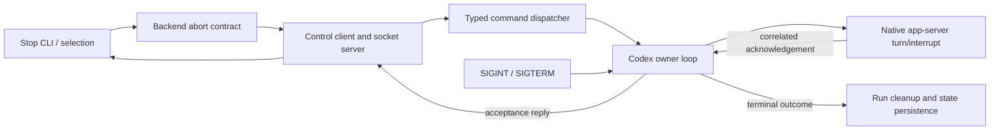
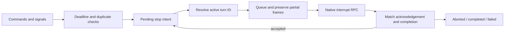
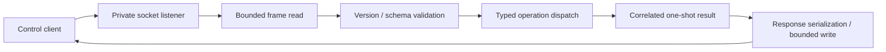

# PR #12 — line-by-line CODE.md audit and remediation

The original audit reviewed `origin/main...HEAD` from main base `b2ccb02923c19bf083fc3d3d6e11c3cf17fd4fef` through `8653923bb01e90dc62a8b5582b3abfbda78b3428`. This remediation uses that complete 62-row inventory and refreshes evidence against the final source in the report's own commit. Future revisions require reassessment.

Read for remediation: `/home/chad/.pi/agent/CODE.md`, repository `AGENTS.md`, full assigned ticket/agent instructions, the exhaustive audit, relevant waap skill, and affected implementation/tests. Scope includes README.md; specs/codex-control-stop.md; src/agent.rs; src/agent/{backend,claude,codex,commands,control,opencode,run,stop,unsupported_commands}.rs; control/{client,protocol,server,socket/connection}.rs; src/app.rs; tests/{agent_execution,agent_steering}.rs, plus parallel unit-test files introduced here. No dependency or persisted schema change.

Status assesses this PR and relevant surrounding code, not the whole repository. Partial means a concrete unresolved tradeoff or verification limit. Each originally Partial row below explicitly records its fix, review disposition and any remaining limitation. Exact guidance and all 62 rows are retained; subjective requirements are not automatically upgraded after a refactor.

## Findings and remediation

Moved 16 unit-test modules from the 14 affected source modules into parallel `*_tests.rs` files using `#[path]`, retaining private access and prior module visibility. Renamed Codex steering_tests to control_tests. Compared all test function names in the migrated scope: **174 before, 176 after, none removed**; the two additions exercise completion mapping and deadline selection. Untouched repository modules retain their original tests.

Extracted TurnState initialization, immutable deadline/status policies and guarded interrupt enqueueing from the owner loop. Flattened server frame/schema dispatch; separated locked persistence from lock acquisition and required its guard. Renamed internal stop entries to agent_stops and the output helper to describe_outcome; JSON keeps stopped_agents. Named queue/read/version policies and scoped the handler cap locally. Improved busy, exited-backend and accepted-stop timeout guidance. Corrected acceptance-output wording and documented an external-runtime upgrade verification policy.

Native rejection codes remain available without raw prompt-bearing backend text. Acceptance still leaves terminal persistence and cleanup to the owner. No native/transport protocol change, retries, backend-specific orchestration, signal fallback or lock held across network waits was introduced. All existing lifecycle, missing-session, mixed-backend, partial-write, completion-race, signal and resource regressions remain.

Remaining limits: mutable nine-field owner state; substantial orchestration and broad CodexClient responsibilities; inherited seven-argument run setup; superset backend context and lazy OpenCode config; macro/constructor/comment conventions; partial recursive diagrams; privacy-limited diagnostics; runtime maintenance and actual model-service ownership not demonstrated. No live Codex/model run or measured coverage was performed. The stop deadline bounds a responsive owner loop: output writes can stall frame processing, startup precedes socket publication, and child reap lacks its own timeout. These are not universal bounded-shutdown guarantees.

## Directional logical flow

Eight components distinguish acceptance from terminal persistence:

Owner zoom, eight components using the same notation:

Transport zoom, seven components; framing, validation, operation dispatch and reply serialization follow the same directed-flow style:

The command-dispatch zoom is also in specs/codex-control-stop.md. Diagrams do not claim recursively complete coverage of every possible component zoom.

## Exhaustive guidance table

IDs are section-relative hierarchical positions in CODE.md (whose Markdown uses repeated `1.` labels). Parent and child entries each get their own row. Guidance text is copied exactly, including source wording. References have separate rows and are not counted as actionable requirements.

### Architecture

| Item | Exact guidance | Status | Evidence / applicability / provenance |
| --- | --- | --- | --- |
| 1 | Express the code design in a diagram of 5-10 components with directional logical flow. | Compliant | Eight-component directional overview in this report and specs/codex-control-stop.md:28; acknowledgement and persistence have separate edges. Audit documentation retained. |
| 1.1 | Ensure self-similar diagramming property when zooming into any component. | Partial | Improved: added a seven-component transport zoom below, alongside the owner zoom and dispatch zoom in specs/codex-control-stop.md:67. Retained: diagrams do not recursively expand every component; no universal self-similarity claim. |
| 1.2 | Avoid spaghetti code. | Partial | Improved: src/agent/codex.rs:545, src/agent/codex.rs:555 and src/agent/codex.rs:707 extract policies from run_turn; src/agent/control/server.rs:61 removes nested frame/schema dispatch. Retained: framing, completion and native acknowledgement still share one owner loop. |
| 2 | Prefer composable designs with interchangeable components that express different application behaviors. | Compliant | src/agent/backend.rs:104 and src/agent/backend.rs:125 provide interchangeable backend routing; src/agent/stop.rs:114 branches only on the outcome. Existing composition preserved. |
| 3 | Generally prefer immutable data structures, since immutable code is easier to reason about. | Partial | Improved: deadline/outcome calculations are immutable reads in src/agent/codex.rs:545 and src/agent/codex.rs:555. Retained: src/agent/codex.rs:518 must mutate partial-write, RPC and completion state on its single owner; no unsafe immutable redesign. |
| 4 | Make as many simplifying assumptions while still fully implementing the functionality and assert then as preconditions in the code, rather than handling every possible edge case. | Compliant | src/agent/control/protocol.rs:57 validates version/method/variant, src/agent/codex.rs:718 checks expiry/duplicates, and src/agent/codex.rs:707 returns unless stop intent and an active turn exist. No retry/discovery fallback. |

### Responsibilities

| Item | Exact guidance | Status | Evidence / applicability / provenance |
| --- | --- | --- | --- |
| 1 | Ensure clear contracts between components. Each component should have a clear responsibility and a clear hand-off to the next component. | Compliant | src/agent/commands.rs:39 separates payloads, src/agent/backend.rs:92 defines acceptance versus completion, src/agent/stop.rs:114 hands terminal persistence to the owner after acceptance. src/agent/run.rs:193 drains and cleans resources. |
| 2 | Check preconditions at the beginning of functions; return or throw if they fail. | Compliant | src/agent/commands.rs:106 rejects expired dispatch first; src/agent/codex.rs:707 isolates interruption preconditions; src/agent/stop.rs:94 validates explicit status under lock before I/O. |
| 3 | Each function does only one thing and does it well. | Partial | Improved: src/agent/codex.rs:545, src/agent/codex.rs:555, src/agent/control/server.rs:61 and src/agent/stop.rs:150 isolate policies and persistence. Retained: src/agent/codex.rs:569 and src/agent/stop.rs:114 still orchestrate multiple handoffs; splitting every branch would obscure event ordering. |
| 4 | When a function has a side effect, it should do that only. | Partial | Improved: extracted side-effect-free deadline/outcome queries at src/agent/codex.rs:545 and src/agent/codex.rs:555. Retained: src/agent/codex.rs:791 mutates the queue and returns its ID; src/agent/stop.rs:150 commits and returns report/commit. Strict effect-only command separation remains unmet. |

### Code Structure

| Item | Exact guidance | Status | Evidence / applicability / provenance |
| --- | --- | --- | --- |
| 1 | Group components by functionality, not by type. | Compliant | src/agent/control/server.rs:9, src/agent/commands.rs:81 and src/agent/stop.rs:114 group transport, dispatch and stop behavior by function. Test files parallel their production modules. |
| 1.1 | Avoid catch-all files that have only data structures. | Compliant | src/agent/commands.rs:57 and src/agent/backend.rs:111 keep behavior with data; src/agent/codex.rs:530 adds directly used state queries, with no catch-all types file. |
| 2 | Prefer shallow indentation. Use early returns and focused helpers to reduce nesting. | Compliant | Fixed the identified nesting: src/agent/control/server.rs:61 uses early returns for framing/schema failures and one operation match; src/agent/codex.rs:707 uses guarded returns. Existing src/agent/codex.rs:718 retains early rejection. Scoped assessment of changed control/stop logic, not a repository-wide nesting certificate. |
| 2.1 | Separate wrappers, such as lock acquisition, from core logic; encapsulate conditional logging in a helper. | Partial | Improved: src/agent/stop.rs:142 now only acquires the lock and delegates; src/agent/stop.rs:150 requires a guard reference, and src/agent/stop.rs:128 runs outside the lock. Retained: src/agent/run.rs:209 still conditionally logs inline; a one-call logging wrapper adds little clarity. |
| 3 | Avoid meta-programming wherever possible; prefer explicit code that is easy to inspect and reason about. | Partial | Reviewed and retained: src/agent/commands.rs:37 uses serde derives and src/agent/codex.rs:70 uses the established Tokio owner-loop primitive. Replacing these with manual serialization/polling would increase protocol and cancellation risk; literal macro avoidance remains partial. |
| 3.1 | Apply the same principle to configuration: prefer static config files over dynamic files rewritten at runtime. | Compliant | Cargo.toml:7 remains static. src/agent/codex.rs:185 and src/agent/opencode.rs:29 read environment configuration without rewriting config; src/agent/stop.rs:211 writes application state only. |

### Eliminate Debt

| Item | Exact guidance | Status | Evidence / applicability / provenance |
| --- | --- | --- | --- |
| 1 | Dead code should be removed. | Compliant | src/agent/codex.rs:40 uses the control client, replacing process-name matching in the PR; src/agent/commands.rs:5 replaces steering-only error terminology. Clippy passes; this is not a proof of all reachability. |
| 2 | Repair code as you go to avoid accumulating debt and confusing defects before they spread. | Partial | Improved: removed inline test-layout debt, clarified internal stop names at src/agent/stop.rs:19, and extracted turn policies at src/agent/codex.rs:545. Retained: src/agent/codex.rs:569 and src/agent/run.rs:59 remain substantial orchestration functions; no claim of total debt elimination. |

### Abstractions

| Item | Exact guidance | Status | Evidence / applicability / provenance |
| --- | --- | --- | --- |
| 1 | Consider data-object anti-symmetry: | Compliant | src/agent/commands.rs:39 remains explicit operation data and src/agent/backend.rs:104 a concrete backend sum type. No additional hierarchy is introduced. |
| 1.1 | Use data structures when you expect to add more functions over time since adding functions on existing data structures doesn't require modifying the existing data structures. | Compliant | src/agent/commands.rs:39 is inspected by serialization, validation and dispatch; src/agent/control/protocol.rs:57 validates data without a new handler interface. |
| 1.2 | Use class interfaces when you expect to add more class implementations over time since adding more implementations doesn't require modifying existing interfaces. | Not applicable | src/agent/backend.rs:104 deliberately models a closed set of three implementations, not an extensible class/plugin interface. No forecast of additional classes is introduced by this remediation. |
| 2 | Use abstractions to minimize the amount components need to know about each other. | Compliant | src/agent/stop.rs:114 consumes AbortOutcome; src/agent/control/server.rs:61 dispatches typed operations without native turn IDs. src/agent/codex.rs:707 alone builds interruption parameters on the owner. |
| 3 | Ensure internal component details do not 'leak' so that external components need to know more than just the interface. | Partial | Reviewed and retained: src/agent/backend.rs:97 is a superset context (agent/control root for Codex, session for direct backends). Backend-owned validation is preserved; replacing it with caller-selected backend-specific variants would reintroduce routing knowledge into stop. Native RPC details stay private at src/agent/codex.rs:707. |
| 4 | Too many abstractions increase cognitive load. Balance encapsulation versus abstraction count. | Compliant | src/agent/codex.rs:530 adds directly consumed queries and src/agent/stop.rs:150 isolates an existing lock boundary; no generic handler, new trait or speculative phase hierarchy is added. |

### Scoping

| Item | Exact guidance | Status | Evidence / applicability / provenance |
| --- | --- | --- | --- |
| 1 | Prefer minimal scoping. | Compliant | src/agent/codex.rs:482 and src/agent/codex.rs:518 remain private; src/agent/control/server.rs:9 restricts visibility to agent. Test modules preserve the prior visibility through path attributes. |
| 1.1 | Keep variables and methods in the smallest scope possible. | Compliant | src/agent/control/server.rs:26 is scoped inside run; src/agent/commands.rs:87 is scoped inside create_channel; src/agent/codex.rs:590 is local to run_turn. src/agent/stop.rs:142 confines the state lock lifetime. |
| 1.2 | Global constants which are only used by a single function are not minimally scoped. possible exception for app configurations. | Compliant | Fixed: moved the sole production consumer's handler limit into src/agent/control/server.rs:26. STOP_TIMEOUT at src/agent/codex.rs:480 is shared by intent and acknowledgement paths. PROTOCOL_VERSION at src/agent/control/protocol.rs:5 is shared by construction, parsing and client validation. |
| 1.3 | Variables and methods are exposed on a need-to-know basis. | Compliant | src/agent/commands.rs:54 remains private; src/agent/codex.rs:974 is private. Parallel test modules at src/agent/codex.rs:1041 access internals without widening production visibility. |

### Naming

| Item | Exact guidance | Status | Evidence / applicability / provenance |
| --- | --- | --- | --- |
| 1 | Prefer descriptive names. | Compliant | src/agent/stop.rs:30 names the explicit outcome; src/agent/commands.rs:86 identifies the factory; src/agent/codex.rs:707 names its queueing effect. SIGINT/SIGTERM terminology remains distinct from native interruption. |
| 2 | Start function names with verbs. | Partial | Improved: renamed header to describe_outcome (src/agent/stop.rs:30) and channel to create_channel (src/agent/commands.rs:86); new compute_deadline/resolve_status/enqueue_interrupt use verbs. Retained: idiomatic new/from constructors and src/agent/commands.rs:17/src/agent/commands.rs:11 remain constructor-pattern exceptions. |
| 3 | Name the same concept consistently throughout the code. | Compliant | Fixed: src/agent/stop.rs:19 now names internal accepted/completed stop entries; src/agent/codex.rs:1041 replaces steering_tests. src/agent/stop.rs:54 retains the versioned JSON key explicitly documented in specs/codex-control-stop.md:81. Compatibility vocabulary is confined to the wire contract. |
| 4 | Use existing terminology rather than inventing new terms where possible. | Compliant | src/agent/codex.rs:150 retains native turn/interrupt terminology; src/agent/codex.rs:215 preserves wire interrupted while src/agent/codex.rs:555 maps only acknowledged interruption to persisted Aborted. |
| 5 | Avoid magic numbers. | Compliant | Fixed the audited literals: src/agent/codex.rs:590, src/agent/commands.rs:87 and src/agent/control/protocol.rs:5 name read capacity, queue policy and shared wire version. STOP_TIMEOUT and ACK_TIMEOUT remain named; literal wire fixtures independently verify version 1. |
| 6 | Avoid double negatives: use positive conditions like `if verbose` instead of `if not no_verbose`. | Compliant | src/agent/codex.rs:631 uses a single negation and src/agent/control/server.rs:32 a positive-state predicate. No double-negative option introduced. |

### Comments

| Item | Exact guidance | Status | Evidence / applicability / provenance |
| --- | --- | --- | --- |
| 1 | Avoid descriptive comments; make code so readable it explains itself. | Partial | Improved: removed the restated server-draining and bounded-queue test comments; readable flow is at src/agent/control/server.rs:50 and src/agent/commands_tests.rs:9. Retained: src/agent/control.rs:13 and src/agent/backend.rs:90 document timing/ownership contracts not obvious from types. Literal descriptive-comment avoidance remains partial. |
| 2 | Don't leave a work log in the code. Preserve only the best and most correct logic. Use the git history if you want to see a prior version. | Compliant | src/agent/codex.rs:478 documents current policy. Chronological remediation progress lives in the external waap agent work_log.md, not source comments. No abandoned implementation retained. |

### Dependencies

| Item | Exact guidance | Status | Evidence / applicability / provenance |
| --- | --- | --- | --- |
| 1 | You own the entire stack including the dependency. | Partial | Improved: specs/codex-control-stop.md:103 identifies external app-server responsibility, disposable live checks and rollback. Retained: src/agent/codex.rs:357 invokes an external runtime/model stack whose ownership is not established by source or fakes. |
| 2 | Including a dependency means you are committing to maintaining the dependency. | Partial | Improved: specs/codex-control-stop.md:108 specifies a concrete upgrade verification/rollback policy; Cargo.toml:7 and Cargo.lock:1 introduce no dependency. Retained: documentation cannot demonstrate ongoing dependency maintenance or a completed live upgrade check. |
| 3 | Prefer open-source dependencies since you can't maintain closed source ones. | Compliant | Cargo.toml:7 retains existing open-source Rust crates and no new dependency. Runtime/model ownership remains explicitly limited under Dependencies.1; no closed-source library was introduced. |

### Logging

| Item | Exact guidance | Status | Evidence / applicability / provenance |
| --- | --- | --- | --- |
| 1 | Prefer a logger over print statements. | Compliant | src/agent/run.rs:209 and src/agent/control/server.rs:33 use the logger for diagnostics. src/agent/stop.rs:38 prints requested CLI output only. |

### Errors

| Item | Exact guidance | Status | Evidence / applicability / provenance |
| --- | --- | --- | --- |
| 1 | A user-facing error should clearly indicate what the user needs to do to resolve the error. | Partial | Improved: src/agent/commands.rs:122 tells users to wait; src/agent/commands.rs:126 directs status inspection; src/agent/codex.rs:497 directs status/log inspection with no automatic retry. Retained: src/agent/codex.rs:722 and some inherited startup/I/O errors are still terse; not every error has a complete recovery recipe. |
| 2 | Internal errors should include enough detail to debug the issue to root cause and fix. | Partial | Preserved: src/agent/codex.rs:974 keeps numeric RPC codes and src/agent/codex_control_tests.rs:7 checks backend-text privacy. Retained: src/agent/control/server.rs:33 omits panic payload and malformed acknowledgements omit raw backend data to avoid prompt disclosure. No unsafe raw diagnostics added; root-cause detail remains limited. |

### Feel

| Item | Exact guidance | Status | Evidence / applicability / provenance |
| --- | --- | --- | --- |
| 1 | Eliminate common code smells: | Partial | Improved: constructor/policy extraction at src/agent/codex.rs:530, flatter transport dispatch at src/agent/control/server.rs:61, parallel tests and explicit stop naming. Retained: the following individual smell rows record remaining orchestration/state complexity; no smell-free claim. |
| 1.1 | Vague or unclear names | Compliant | Fixed each cited name: src/agent/stop.rs:30 replaces header, src/agent/commands.rs:86 replaces channel, and src/agent/codex.rs:1041 replaces steering_tests. src/agent/stop.rs:19 describes entries irrespective of acceptance versus completion. |
| 1.2 | Frequently repeated code | Partial | Improved: src/agent/codex.rs:531 centralizes nine-field TurnState initialization used by production and four test setups. Retained: src/agent/codex.rs:974 and src/agent/codex.rs:1002 repeat error-shape checks; method-specific validity and unsupported-version rules remain explicit rather than a generic parser that could blur acceptance semantics. |
| 1.3 | Overly long functions | Partial | Improved: run_turn shrank from 103 to 70 lines (signature through closing brace), with deadline/status/interrupt policies extracted at src/agent/codex.rs:545, src/agent/codex.rs:555 and src/agent/codex.rs:707. Retained: src/agent/run.rs:59 is still substantial orchestration; more splitting would be unrelated lifecycle churn. |
| 1.4 | Classes with an excessive number of methods | Partial | Improved: immutable policy queries now belong to TurnState at src/agent/codex.rs:530. Retained: CodexClient still owns framing/dispatch/native-response methods across src/agent/codex.rs:659 and src/agent/codex.rs:863. A new transport hierarchy is deferred because ownership/cancellation ordering is safety-critical. |
| 1.5 | Data structures with an excessive number of fields | Partial | Improved: src/agent/codex.rs:531 centralizes the initial object contract and prevents repeated partial initialization. Retained: src/agent/codex.rs:518 still has nine fields; early completion, pending steer/write/interrupt and stop phases need correlation. A larger phase-type redesign is outside this focused remediation. |
| 1.6 | Long parameter lists | Partial | Reviewed and retained: src/agent/run.rs:37, src/agent/run.rs:59 and src/agent/run.rs:132 retain seven parameters. These inherited setup contracts span path/output/backend ownership; introducing a broad context solely for arity would be unrelated abstraction churn. |
| 1.7 | Unnecessary global scoping | Compliant | Fixed: src/agent/control/server.rs:26 now lives inside its only production consumer; src/agent/commands.rs:87 and src/agent/codex.rs:590 are local. Shared timeout/protocol constants retain multiple real consumers. |
| 1.8 | Excessive mutation | Partial | Improved: src/agent/codex.rs:545 and src/agent/codex.rs:555 isolate immutable decisions, and src/agent/codex.rs:707 confines a queue transition. Retained: src/agent/codex.rs:825 mutates offsets/correlation and src/agent/opencode.rs:29 lazily initializes existing environment config. Single-owner phase mutation remains necessary. |
| 1.9 | Adding an apparently isolated feature requires modifying the entire codebase. | Compliant | src/agent/stop.rs:114 still uses the common backend contract. Edits are confined to PR-affected modules/tests and stop documentation; ticket/state/root/Git implementations and untouched unit modules remain unchanged. Most changed lines are test relocation. |
| 1.10 | Unnecessary, "just-in-case" abstractions where the abstraction is not needed yet. | Compliant | src/agent/codex.rs:530 supplies policies consumed immediately by run_turn; src/agent/stop.rs:150 receives the actual lock guard. No unused strategy, trait or future-only abstraction introduced. |
| 1.11 | Inconsistently populated objects | Partial | Improved: src/agent/codex.rs:531 guarantees consistent initial turn fields; src/agent/commands.rs:39 continues to forbid optional-prompt combinations. Retained: src/agent/backend.rs:97 permits unused session/control data by backend, and src/agent/opencode.rs:29 guards optional lazy configuration. Backend-owned requirements preserved rather than shifted to callers. |
| 1.12 | Missing cleanup | Compliant | src/agent/run.rs:193 drains responses, closes the socket and cleans the runner; src/agent/run.rs:179 cleans the worktree. tests/agent_execution.rs:371 and tests/agent_execution.rs:754 retain signal/error/resource checks; owned-child cleanup remains at src/agent/process.rs:12. |

### Testing

| Item | Exact guidance | Status | Evidence / applicability / provenance |
| --- | --- | --- | --- |
| 1 | Untested code doesn't work. All code must be tested. | Partial | Improved: src/agent/codex_control_tests.rs:1081 covers acknowledged/unacknowledged/natural outcomes; src/agent/codex_control_tests.rs:1111 covers deadline selection and replied-steer exclusion. All 174 migrated tests retained. Retained: no measured line/branch coverage or live Codex/model check; cannot claim every line tested. |
| 2 | Follow the test-level pyramid approach using mostly unit tests, integration tests that combine components, and end-to-end tests which verify functionality from a user perspective. | Partial | Preserved and extended: unit regressions in src/agent/codex_control_tests.rs:1081 join CLI/process/state integration in tests/agent_execution.rs and tests/agent_steering.rs. 362 unit and 55 integration tests passed. Retained: fake app-server user-flow coverage does not establish actual backend/model E2E compatibility. |
| 3 | For unit tests, use a parallelly named test file, e.g. for Python, use test_${module}.py for unit tests in ${module}.py, or for TypeScript, use ${module}.test.ts for unit tests in ${module}.ts. | Compliant | Fixed: all 16 unit modules in 14 PR-affected source modules now load parallel files, including src/agent.rs:422 and e.g. src/agent/codex.rs:1040, src/agent/commands.rs:139 and src/agent/control/protocol.rs:139. All 174 existing tests remain, plus two new regressions; unrelated repository unit modules were not relocated. |

### References

| Item | Exact guidance | Status | Evidence / applicability / provenance |
| --- | --- | --- | --- |
| 1 | Clean Code by Martin | Not applicable | Acknowledged reference: Clean Code by Martin. CODE.md supplies the actionable guidance; no claim to have read or independently audited the book. |
| 2 | Pragmatic Programmer by Hunt | Not applicable | Acknowledged reference: Pragmatic Programmer by Hunt. Reference rather than executable acceptance criterion. |
| 3 | Why Functional Programming Matters by Hughes | Not applicable | Acknowledged reference: Why Functional Programming Matters by Hughes. Immutability preference assessed explicitly above; paper not independently consulted. |
| 4 | Structure and Interpretation of Computer Programs by Abelson | Not applicable | Acknowledged reference: Structure and Interpretation of Computer Programs by Abelson. Reference rather than an additional inferred checklist. |

## Coverage and validation

All **58 actionable items plus four references = 62/62 rows** remain covered. Before: **25 Compliant, 31 Partial, 1 Noncompliant, 5 Not applicable**. After: **32 Compliant, 25 Partial, 0 Noncompliant, 5 Not applicable**. Six Partial rows are fixed (Code Structure.2, Scoping.1.2, Naming.3, Naming.5, Feel.1.1, Feel.1.7); Testing.3 changes from Noncompliant to Compliant. All other Partial rows retain explicit per-row dispositions and limits.

All five commands ran from the repository root with unrestricted filesystem/process access and no command sandbox, on the final Rust source. Each exited 0:

| Command | Actual result |
| --- | --- |
| `cargo fmt --check` | Passed (exit 0) |
| `cargo clippy --all-targets -- -D warnings` | Passed (exit 0) |
| `cargo build` | Passed (exit 0) |
| `cargo build --release` | Passed (exit 0) |
| `cargo test` | Passed (exit 0) |

`cargo test`: **417 passed**, 0 failed, 0 ignored: **362 unit + 55 integration** (15 agent_execution, 8 agent_steering, 3 repair, 9 root_and_validation, 20 state_commits). Original audit: 415 = 360 unit + 55 integration. No removed test functions in migrated modules; two policy regressions added. `git diff --check` passed. Fake-server checks establish protocol/lifecycle behavior, not actual runtime/model compatibility or full branch coverage. The upgrade-check policy in specs/codex-control-stop.md is a documented future operational obligation, not a live check claimed here.
