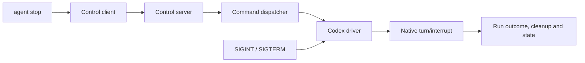

+++
status = "final"
created = 2026-11-01
last_update = 2026-11-02
+++

# Codex stop through run control

## Purpose

Stop a running Codex agent through its existing control socket and command dispatcher, without process-name matching. Preserve graceful native interruption and cleanup.

## Goals

- Route Codex `waap agent stop` to the live run owner.
- Retain SIGINT/SIGTERM handling and native `turn/interrupt`.
- Persist intentional successful interruption as `aborted` without racing the stop CLI.

## Non-goals

- Changing Claude or OpenCode stop behavior.
- Process discovery, stale-state repair, automatic retries, or a `pkill` fallback.
- Replacing Codex app-server or adding another session/turn.

## Specification

The control protocol must add a prompt-free `stop` method while preserving existing version-1 steering requests and validation. Unsupported backends must reject socket stop without changing their existing CLI stop behavior.

The Codex driver must handle stop on its owner loop using the current thread and turn. Stop and OS signals must share native interruption machinery; SIGINT/SIGTERM support remains. An accepted stop before the turn ID is available must retain its intent until interruption can be sent. Stop must not wait behind a steering acknowledgement, corrupt partially written frames, or start another turn. Requests must remain bounded and correlated.

The response must distinguish confirmed acceptance from rejection and uncertain delivery. Queueing alone is not successful native acceptance. Shutdown must allow a correlated stop response to reach the caller before disposing of its connection. All waits must be bounded by documented timeouts; transport loss must not trigger automatic retry or signal fallback. Existing app-server cleanup may still terminate its owned child; removing process-name matching does not prohibit owned-child cleanup.

The Codex run owner must persist `aborted` after an intentional stop or signal successfully interrupts the run, and perform socket, child, and worktree cleanup. A rejected or failed interrupt must remain a failure rather than being mislabeled a successful abort. Natural completion and unrelated errors retain existing semantics; terminal state must not be overwritten by a racing CLI. The stop CLI must not hold the state lock while waiting on the owner or independently mark a live Codex run aborted. Existing human/JSON stop reporting should remain compatible, documenting any necessary acknowledgement-versus-completion distinction.

Missing or stale sockets, legacy live runners lacking stop support, and startup races must produce clear errors without claiming that the agent stopped or repairing state. Ready-agent stop and CLI stop-all selection remain supported. Mixed backend stop-all must preserve Claude/OpenCode behavior without deadlocking Codex finalization. No persisted-state migration is required.

## Verification

- Protocol/client/dispatcher tests for stop, malformed frames, method-specific prompt validation, correlation, rejection, uncertainty, bounded queues and deadlines; steering regressions remain green.
- Codex tests for native stop payload, pre-turn stop, pending steering, partial writes, duplicate interruption, acknowledgement loss/rejection, completion races and both signals.
- CLI/run integration with fake Codex covering stop-one and stop-all, mixed backend routing, no `pkill`, response delivery, lock release, runner-owned `aborted` persistence, failure classification and socket/worktree/child cleanup.
- Preserve ready-agent stop and Claude/OpenCode regression tests.
- Run repository validations: `cargo fmt --check`, `cargo clippy --all-targets -- -D warnings`, `cargo build`, `cargo build --release`, and `cargo test`.
