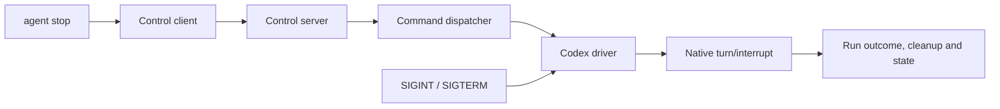
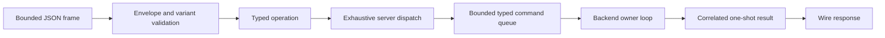

+++
status = "final"
created = 2026-11-01
last_update = 2026-11-02
+++

# Codex stop through run control

## Purpose

Stop a running Codex agent through its existing control socket and command dispatcher, without process-name matching. Preserve graceful native interruption and cleanup.

## Goals

- Route Codex `waap agent stop` to the live run owner.
- Retain SIGINT/SIGTERM handling and native `turn/interrupt`.
- Persist intentional successful interruption as `aborted` without racing the stop CLI.

## Non-goals

- Changing Claude or OpenCode stop behavior.
- Process discovery, stale-state repair, automatic retries, or a `pkill` fallback.
- Replacing Codex app-server or adding another session/turn.

## Specification

The control protocol must add a prompt-free `stop` method while preserving existing version-1 steering requests and validation. Unsupported backends must reject socket stop without changing their existing CLI stop behavior.

The Codex driver must handle stop on its owner loop using the current thread and turn. Stop and OS signals must share native interruption machinery; SIGINT/SIGTERM support remains. An accepted stop before the turn ID is available must retain its intent until interruption can be sent. Stop must not wait behind a steering acknowledgement, corrupt partially written frames, or start another turn. Requests must remain bounded and correlated.

The response must distinguish confirmed acceptance from rejection and uncertain delivery. Queueing alone is not successful native acceptance. Shutdown must allow a correlated stop response to reach the caller before disposing of its connection. All waits must be bounded by documented timeouts; transport loss must not trigger automatic retry or signal fallback. Existing app-server cleanup may still terminate its owned child; removing process-name matching does not prohibit owned-child cleanup.

The Codex run owner must persist `aborted` after an intentional stop or signal successfully interrupts the run, and perform socket, child, and worktree cleanup. A rejected or failed interrupt must remain a failure rather than being mislabeled a successful abort. Natural completion and unrelated errors retain existing semantics; terminal state must not be overwritten by a racing CLI. The stop CLI must not hold the state lock while waiting on the owner or independently mark a live Codex run aborted. Existing human/JSON stop reporting should remain compatible, documenting any necessary acknowledgement-versus-completion distinction.

Missing or stale sockets, legacy live runners lacking stop support, and startup races must produce clear errors without claiming that the agent stopped or repairing state. Ready-agent stop and CLI stop-all selection remain supported. Mixed backend stop-all must preserve Claude/OpenCode behavior without deadlocking Codex finalization. No persisted-state migration is required.

## Typed request contract

Version and UUID request ID belong to the wire envelope. Its operation is a
closed enum: `Steer { prompt: String }` or `Stop`. Serialization preserves the
version-1 flat objects: steering has `method: "steer"` and `prompt`, while stop
has `method: "stop"` and no prompt field. Parsing at the protocol boundary
validates envelope metadata, reports unsupported versions and unknown methods,
and rejects unknown fields and invalid variant payloads. Steering requires a
nonempty string after trimming for validation, while preserving the original
text. Stop rejects a prompt of any type, including null.

The server exhaustively matches the typed operation. In-process dispatch accepts
that operation and a deadline, then queues a typed command: steer carries its
prompt and reply context; stop carries only its reply context. The shared reply
context owns the deadline and one-shot response sender, with no operation-specific
fields. Adding an operation requires explicit schema, dispatch and backend match
arms. Generic commands use `CommandResult` and `CommandError`, with rejection
separate from unknown acceptance and method-specific rejection diagnostics.

The following detail expands the command-dispatch component above:

For Codex, successful CLI output confirms native acceptance; cleanup and terminal
persistence may still be in progress. JSON retains `stopped_agents` and `commit`:
a reported agent may still be `running`, and a Codex-only stop has `commit: null`
because the owner commits its final status. Human output says `Stop accepted for
agent` whenever the explicit outcome is acceptance, even if a reload already sees
a terminal status; `waap agent get` reports the final state.

Connect and frame I/O each allow five seconds. Native acknowledgement allows
30 seconds plus five seconds for response delivery. Interrupted completion is
bounded to 30 seconds after acknowledgement. Shutdown drains bounded in-flight
handlers before removing the socket. Missing/stale sockets, startup before socket
publication, or older runners lacking stop support return errors without changing
state. Lost delivery or acknowledgement reports unknown acceptance without retry
or signal fallback.

## Pi integration

Pi reuses the same stop operation, client, server, dispatcher, acceptance
reporting, owner-only terminal persistence, and cleanup contracts. Its native
clear-queue/abort sequence and preflight ordering differ from Codex and are
specified in [Pi agent system](pi-agent-system.md). Codex interruption continues
to use its existing native turn/interrupt path.

## Verification

- Protocol/client/dispatcher tests for stop, malformed frames, method-specific prompt validation, correlation, rejection, uncertainty, bounded queues and deadlines; steering regressions remain green.
- Codex tests for native stop payload, pre-turn stop, pending steering, partial writes, duplicate interruption, acknowledgement loss/rejection, completion races and both signals.
- CLI/run integration with fake Codex covering stop-one and stop-all, mixed backend routing, no `pkill`, response delivery, lock release, runner-owned `aborted` persistence, failure classification and socket/worktree/child cleanup.
- Preserve ready-agent stop and Claude/OpenCode regression tests.
- Run repository validations: `cargo fmt --check`, `cargo clippy --all-targets -- -D warnings`, `cargo build`, `cargo build --release`, and `cargo test`.

## Runtime maintenance and verification limits

Codex app-server is an external executable. Changes to its native protocol must
retain version-1 control JSON and run the fake app-server rejection, malformed
response, lost acknowledgement, completion-race, signal and cleanup regressions.
Before deploying a Codex upgrade, verify stop and steer with that actual version
in a disposable run, record the version/result, and retain the previously working
executable for rollback. Never retry an interrupt automatically after unknown
acceptance. The repository checks cannot replace that live compatibility check;
no live version or model-service maintenance ownership is established here.

The stop deadline applies to a responsive owner loop. A blocked output write can
delay the loop, initialization precedes socket publication, and owned-child reap
has no independent timeout. These remain limitations of bounded shutdown.
