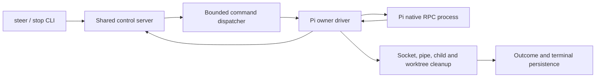

+++
status = "draft"
created = 2026-10-20
last_update = 2026-11-06
+++

# Pi agent system

## Purpose

Run Pi Coding Agent directly from WAAP, with durable session tracking and native
steering and stop through the shared control server. Pi is the default for
`agent run`; explicit `opencode`, `claude`, and `codex` remain available.

## Context

Pi RPC is the language-neutral subprocess interface for WAAP's Rust runtime.
Session files remain Pi's persistence format; they must not drive live state.
The shared runtime, command dispatcher, control socket, and lifecycle defined in
[agent steering](agent-steering.md) and [Codex stop](codex-control-stop.md) remain
authoritative. Pi adds a backend and driver to those components.

## Goals

- Obtain and persist an authentic Pi session ID before submitting task work.
- Preserve Pi model, reasoning, auth, resource discovery, and session behavior.
- Forward assistant text and wait for session-level settlement.
- Steer and stop live Pi through correlated native acknowledgements.
- Leave terminal persistence and resource cleanup to the run owner.

## Non-goals

- Exposing every Pi RPC command or adding a second control server.
- Attaching to, resuming, or steering a completed WAAP run.
- Changing Codex, Claude, or OpenCode native protocols.
- Defining a new sandbox, remote Pi service, or model-provider client.
- Supervising arbitrary processes detached by third-party Pi extensions.

## Specification

### Architecture



The seven components have the same handoffs as the other shared backends.
`pi.rs` owns startup and the Pi child, `pi/config.rs` handles invocation,
`pi/rpc.rs` handles JSONL and UI/text events, and `pi/session.rs` owns native
command correlation and run state. These components run on the existing
current-thread Tokio runtime. No blocking reader thread, polling loop, signal
matcher, replacement runner trait, or separate control endpoint is required.

### Configuration and invocation

`AgentSystem::Pi` uses the label `pi`, including frontmatter and CLI parsing.
Omitting `--system` must select Pi. Existing stored systems remain unchanged.
A running record without a persisted system must fail stop with an invalid
metadata error and no state change. Ready cancellation remains local and does
not require a backend or socket.

Pi and Codex accept `--model` and `--reasoning-effort`; Claude and OpenCode
reject these options before state changes. Pi accepts `off`, `minimal`, `low`,
`medium`, `high`, `xhigh`, and `max`, forwards the value unchanged to
`--thinking`, and rejects `none` and `ultra`.

| Setting | Pi fallback | Precedence |
| --- | --- | --- |
| Executable | `WAAP_PI_BIN`, then `pi` | Environment |
| Model | `WAAP_PI_MODEL`, then Pi's configured default | CLI first |
| Reasoning | `WAAP_PI_REASONING_EFFORT`, then Pi's configured default | CLI first |

Invalid or empty run configuration must fail before entering `running`. Stop
constructs a configuration-free backend, so invalid run environment cannot
prevent stopping an existing Pi run.

Spawn one child in the agent worktree:

```text
pi --mode rpc --approve --name "waap <agent-id>" \
  [--model <model>] [--thinking <level>]
```

Stdin and stdout are private protocol pipes; stderr is inherited. Session
persistence stays enabled. `--approve` trusts project-local Pi resources for
this autonomous run; it does not implement per-command approvals.

Remove inherited `PI_SESSION_ID`, `PI_SESSION_FILE`, `PI_PROVIDER`, `PI_MODEL`,
and `PI_REASONING_LEVEL`. They describe a parent Pi session, not WAAP run
configuration. Preserve other environment, including `HOME`, credentials,
`PI_CODING_AGENT_DIR`, proxies, and CA settings. Never put credentials in argv,
records, or protocol diagnostics.

### Startup and task outcome

The shared owner must validate readiness/configuration, commit `running` with
the selected system, create the isolated worktree, and start Pi. Startup sends
`get_state` with a unique string ID and requires a matching successful response
with nonempty `data.sessionId`. The owner persists that ID and binds the shared
control socket before submitting the existing common WAAP task prompt.

The driver checks already queued stop intent and ready SIGINT/SIGTERM before
the first prompt write. Such cancellation suppresses task submission and uses
the same native clear/abort path as a live stop. Startup failure, session
persistence failure, or endpoint binding failure must clean the owned child and
worktree without sending a task prompt.

Prompt responses must have a known disposition. `started` or `queued` means
accepted and requires subsequent settlement. `handled` means an extension
consumed the task, so WAAP fails explicitly and cleans up; it must neither wait
forever nor claim completion. This policy also applies when the extension
independently starts other work.

Wait for `agent_settled`, including automatic retries, compaction, and queued
continuations. `agent_end` alone is insufficient. Retain pending native
acknowledgements across settlement; it must not close their control connections.

| Final condition | Outcome |
| --- | --- |
| Latest assistant `stopReason` is `stop` | `Completed` |
| Latest reason is `error`, `length`, or `toolUse` | `Failed(1)` |
| Latest reason is `aborted` | `Aborted` |
| Correlated native stop succeeds | `Aborted` |
| Missing/unknown assistant result, malformed protocol, or premature EOF | Error |

A tool error alone does not determine the outcome. The model may recover.
Shared main behavior maps completed and intentionally aborted runs to owner
exit zero, and errors/failed runs to nonzero. The owner performs cleanup before
committing the terminal status. The stop CLI never writes terminal state for a
live Pi run.

### Steering

`agent steer --agent-id <id> --prompt <text>` uses the existing version-1 control
socket and bounded dispatcher. The driver sends exactly one native
`{id,type:"steer",message:<text>}` command. Submitted text must survive JSON
transport unchanged. Pi may expand templates/skills or transform/consume input
through extensions; WAAP does not emulate steering with another prompt/session.

Success requires the matching native `command:"steer",success:true` response
with disposition `queued` or `handled`. It confirms native handling, not model
execution, continued queue membership, or eventual task success. Settlement may
precede this acknowledgement; drain the acknowledgement before finalizing.

Reject steering while initial prompt preflight or another steering
acknowledgement is pending (`busy`), once stopping (`stopping`), after settlement
(`agent_exited`), or after the request deadline (`timeout`). A native negative
response is a definite `backend_rejected` result and does not itself abort the
run. Uncorrelated responses cannot satisfy a request.

### Stop and signals

`PiBackend::abort` must call the shared `ControlClient::stop` and return
`StopAccepted` only after driver acknowledgement. Do not match argv, signal an
unidentified process, retry automatically, or independently mark the record
aborted. Missing/stale sockets and unpublished startup endpoints return errors.
The state lock must be released before waiting on the live owner.

The driver retains one stop intent, rejects subsequent control commands while
stopping, and completes this bounded sequence:

1. Wait for outstanding initial-prompt or steering preflight to resolve. Pi
   preflight handlers are asynchronous and could otherwise enqueue after clearing.
2. Send `clear_queue` and await its correlated successful acknowledgement.
3. Send `abort` and await its correlated successful acknowledgement. Pi's abort
   waits for idle; `agent_settled` may precede this response.
4. Acknowledge the control request, close Pi stdin, wait for child exit, and
   finish shared socket/worktree cleanup and terminal persistence.

SIGINT/SIGTERM use that same sequence. Native rejection must not be labeled a
successful abort. Settlement or EOF after local stop intent is insufficient
without native acknowledgement. A rejected CLI stop can leave the run active;
queue clearing, if already acknowledged, has removed any pending messages.

Stop acceptance is distinct from completion. Human output says `Stop accepted
for agent`. JSON preserves `stopped_agents` and `commit`; a Pi-only stop has
`commit:null` and may report `running` while the owner finishes cleanup. Inspect
`agent get` for terminal status. Ready cancellation and mixed-system stop-all
keep existing shared behavior.

### Transport, deadlines, and cleanup

Use strict LF-delimited JSON objects with optional CR before LF. Preserve split
UTF-8 and Unicode U+2028/U+2029 inside strings. Serialize each complete command
once and correlate ID, command, success, and disposition where applicable.
Read partial frames into driver-owned storage so cancellation cannot discard
bytes. Do not buffer an unbounded channel of events.

Startup and initial prompt acknowledgement have 30-second deadlines. A control
request's shared 30-second acknowledgement deadline covers native writes,
preflight waits, queue clearing, and abort acknowledgement together. Writes must
honor backpressure asynchronously and be bounded. An interrupted/failed partial
write ends the driver; another JSON command must not be interleaved into it.
There is no overall task runtime limit. Child exit after closing stdin has a
30-second deadline, followed by owned-child termination/reaping on failure.

Before native dispatch, expiry is a definite rejection. After possible delivery,
write failure, lost/malformed acknowledgement, response timeout, and unexpected
exit mean unknown acceptance. Preserve `accepted:null`/`acceptance_unknown` and
no automatic retry. Protocol/transport failures terminate the owner as failed
rather than assuming an intentional abort succeeded.

Only assistant text deltas are forwarded and flushed. Thinking and raw RPC
records are not printed. Dialog UI requests (`select`, `confirm`, `input`,
`editor`) receive correlated cancellation responses. Fire-and-forget UI methods
are ignored. Stdout must continue being consumed while awaiting responses.

Cleanup owns cancellable async pipe handles, with no reader-thread join.
Explicitly drop stdin to deliver EOF; child wait must not depend on descendants
closing stdout. Concurrently drain and validate native JSONL records until the
direct child exits, so shutdown notifications exceeding pipe capacity cannot
block exit. Discard these records without changing the settled outcome or
forwarding protocol data to the operator; stdin is closed, so no UI replies are
sent. Observed malformed records or read failures still fail the owner. Clean
stdout EOF stops draining but does not replace the bounded child wait.
The shared process wrapper owns direct-child kill/reap and
cancellation fallback. Arbitrary detached descendants remain the extension's
responsibility; WAAP does not promise process-group supervision. Native records
have a separate 64 MiB limit, including LF, to accommodate large snapshots while
bounding parser memory; the external control-frame limit remains 64 KiB.
A blocked operator output consumer can delay owner progress, as for Codex.

## Compatibility and migration

Target Pi Coding Agent 0.82.1 or newer with the documented RPC preflight,
`agent_settled`, and UI contracts. The installed 1.0.0 implementation is the
reference exercised during this refresh; the historical minimum needs separate
verification before relying on it. Unknown protocol values fail explicitly.
Pi auth and session files remain managed by Pi. No stored-state migration is
required. Changing the CLI default requires an installed/authenticated Pi unless
a different system is explicitly selected.

## Verification

Conventional inline Rust tests must cover config precedence/validation,
invocation/environment, framing and partial reads/writes, UI cancellation,
stop-reason mapping, all prompt/steer dispositions, correlated success/rejection,
settle-before/after-ack, delayed preflight concurrent with stop, pre-prompt
cancellation, expiry, malformed/lost acknowledgement, and no retry.

Process integration must verify default Pi selection, session commit before
prompt, text forwarding, native steering/clear/abort through the shared socket,
reordered CLI arguments, ready cancellation, terminal persistence by the owner,
stop failure/uncertainty, child reaping, descendant-held stdout, handled input,
and socket/worktree cleanup. Existing Codex, Claude, and OpenCode tests must pass.

The opt-in `tests/pi_real_smoke.py` runs the real installed Pi against a local
SSE provider fixture, executes a tool that writes and commits a file, verifies
steering reaches a later provider request, and stops a streaming run. It uses
an isolated Pi directory and no external credentials. Pass
`--shutdown-notification` to exercise completion and stop with a real extension
emitting a shutdown notification larger than pipe capacity. An authenticated
external provider smoke remains a separate deployment check.

Run all repository validations: clippy with warnings denied, formatting, debug
build, release build, tests outside a sandbox, and `waap check`.

## References

- Installed Pi `README.md`, `docs/rpc.md`, `docs/rpc-commands.md`, `docs/json.md`,
  `docs/cli.md`, and `docs/rpc-extension-ui.md`.
- Installed Pi `dist/modes/rpc/rpc-mode.js` and
  `dist/core/agent-session.js` for asynchronous preflight, queues, and idle abort.
